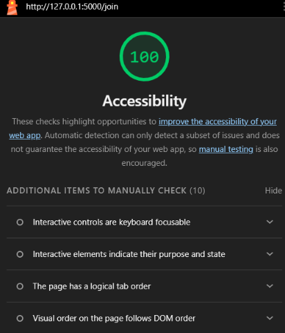
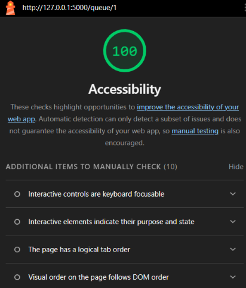
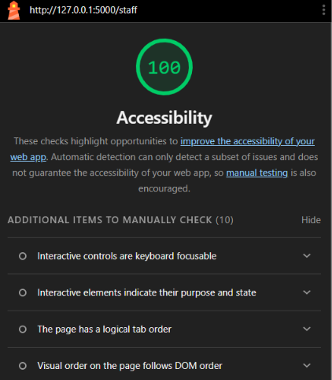

# Week 3 Accessibility Check: KopyaQ

## 9a. Lighthouse (Accessibility, Mobile)

| Screen | First score | Final score | Issues fixed |
| --- | --- | --- | --- |
| Join | | | |
| My place | | | |
| Staff dashboard | | | |

## 9b. Keyboard-only test

- **Join the queue from the home page:** [passed / what failed and how I fixed it]
- **Staff: filter, call and serve:** [passed / what failed and how I fixed it]
- **Focus always visible:** [yes / no]
- **Skip link appears on first Tab:** [yes / no]

## 9c. Manual checklist

| Check | Join | My place | Staff |
| --- | --- | --- | --- |
| Every input has a visible label | ✅ | ✅ (no inputs) | ✅ |
| Error messages say what to do, in text | ✅ | ✅ | ✅ |
| Status is shown in words, not only color | ✅ | ✅ | ✅ |
| Readable at 375 px with no sideways page scroll | | | |
| Buttons are at least about 44 × 44 px on a phone | | | |
| Page has one `<h1>` and headings in order | ✅ | ✅ | ✅ |
| `<html lang="en">` is set | ✅ | ✅ | ✅ |

### Fixes made before testing
- Small buttons (Serve, No-show, filter pills) were about 31 px tall on a phone. Added CSS so they are at least 44 × 44 px below 768 px wide.
- Replaced an `aria-label` on a paragraph with visually hidden text, so screen readers announce "Ticket number" before the number.