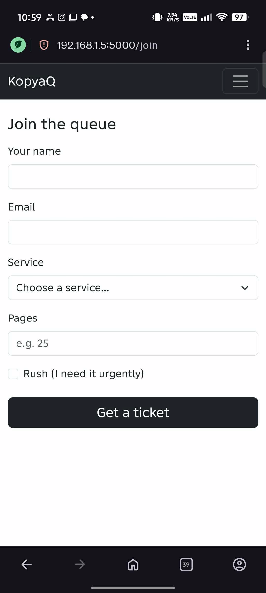
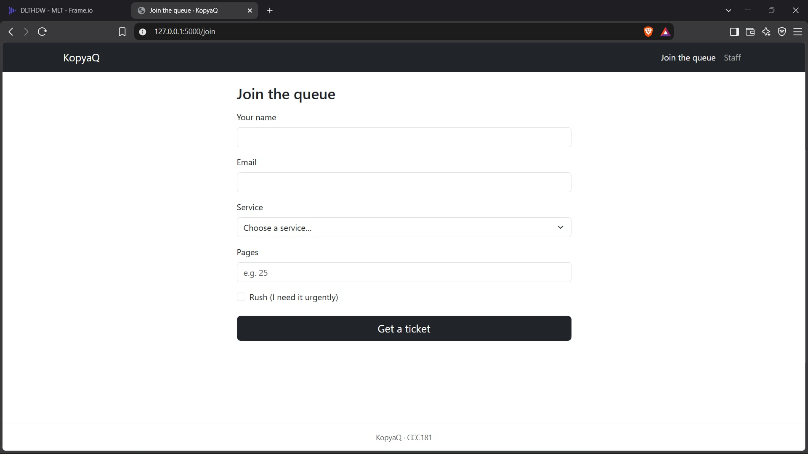
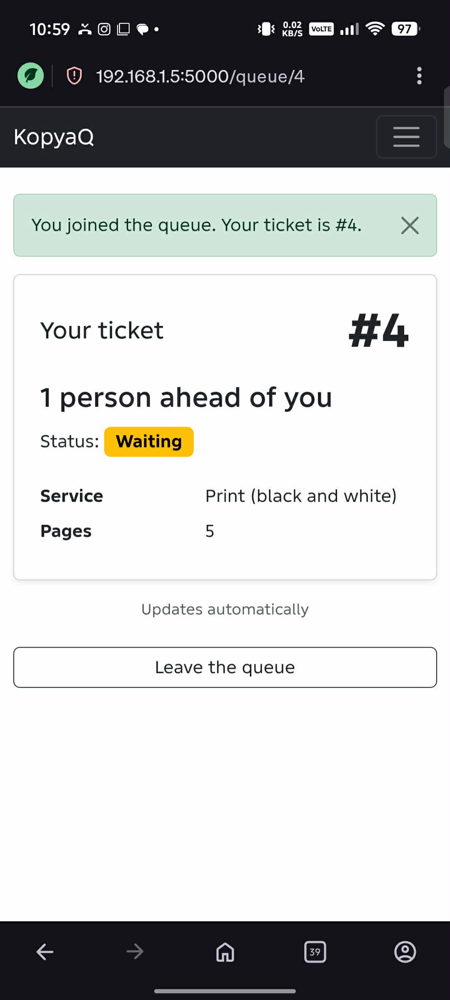
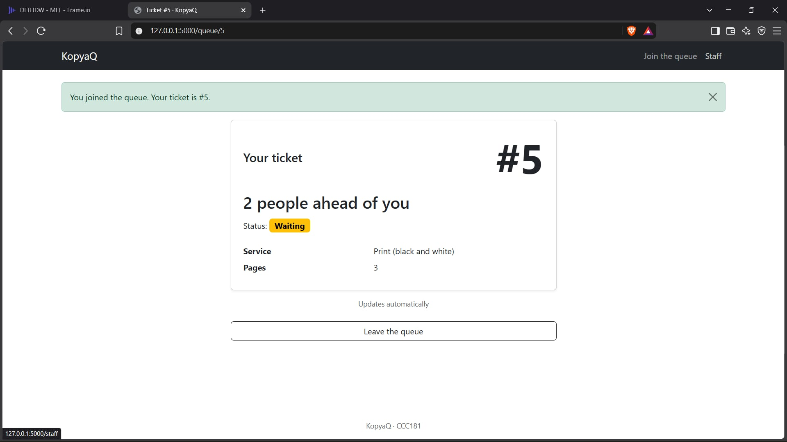
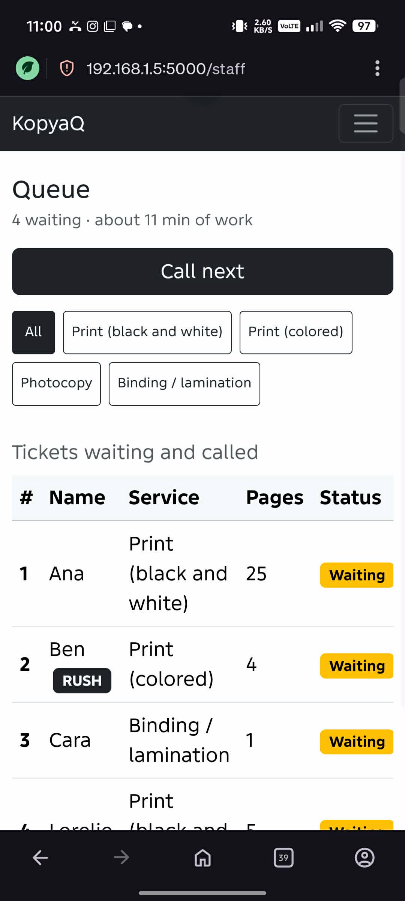
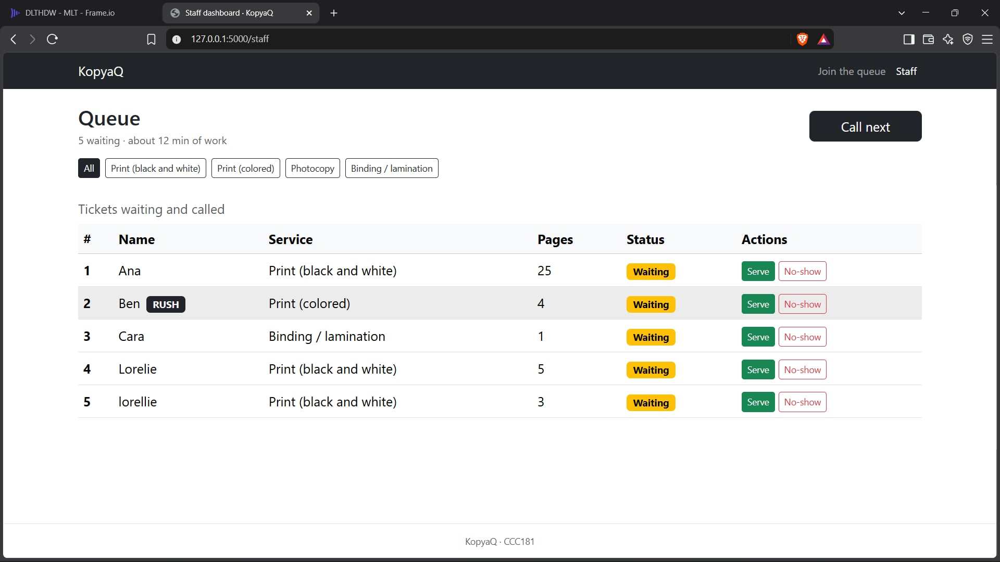

# Week 3 Report: KopyaQ

## 1. Title details

| | |
| --- | --- |
| **App** | KopyaQ |
| **Setting** | A printing and photocopy shop near MSU-IIT |
| **Name** | [Full name] |
| **Student ID** | [ID] |
| **Section** | [Section] |
| **Date** | [YYYY-MM-DD] |
| **Pull request** | [link to the PR, e.g. https://github.com/joashcasino/ccc181/pull/2] |

## 2. Personas

Full personas: [personas.md](personas.md). Details are marked as assumptions because our instructor asked us to skip the interview phase this week.

- **Kyla, the person waiting.** 20, engineering student with back-to-back classes and a budget Android phone. *"I don't mind waiting. I just want to know if I still have time to buy lunch before it's my turn."* Top tasks: join the queue (FR-01), enter pages and rush (FR-03), check her number and position (FR-02), leave the queue (FR-07).
- **Ate Joy, the staff member.** 38, runs a small print shop near the campus gate, usually standing with her hands full. *"Everyone says 'Ate, ako na!' and I can't remember who came first."* Top tasks: call next and serve or mark no-show (FR-04), filter by service (FR-05), see the estimated wait (FR-06).

## 3. Screens

| Screen | Phone | Laptop |
| --- | --- | --- |
| Join |  |  |
| My place |  |  |
| Staff dashboard |  |  |

- **Join** is used by Kyla on her phone at the shop door, and covers FR-01 and FR-03.
- **My place** is used by Kyla while she waits away from the shop, and covers FR-02 and FR-07.
- **Staff dashboard** is used by Ate Joy on the shop desktop, and covers FR-04, FR-05 and FR-06.

## 4. Design decisions

1. **The ticket number and position are the largest text on My place.** Kyla checks her phone one-handed while walking, so the two things she looks for must be readable at a glance (Kyla's rule 1). Status is written as a word in a badge, not shown only by color.
2. **Position is counted per service.** The printers, copier and binding machine run at the same time, so a binding customer should not wait behind a 40-page photocopy job. This also matches the dashboard, where Ate Joy filters by service and calls the next job for that machine.
3. **"Leave the queue" is outlined, separated from the ticket, and asks for confirmation.** In my first wireframe it was a solid button attached to the card, and Kyla could tap it by accident (error prevention, found in my self-review).
4. **KopyaQ manages the line, not the files.** Students already hand over a flash drive or send files through Messenger at the counter. File upload is a *Won't have (this time)* requirement, because storing documents would add privacy risk under RA 10173.

## 5. Self-review

Full review: [feedback.md](feedback.md). Wireframes: [wireframes/](wireframes/).

- **Join:** Service and Pages side by side cut off the dropdown text on a phone, and "e.g. 1 - 2" looked like a range. I stacked the fields full width and changed the placeholder to "e.g. 25".
- **My place:** the position was the smallest text and the Leave button looked like the main action. I enlarged the position and made Leave an outlined, separate button.
- **Staff dashboard:** the first draft had no actions, no selected filter, and a table too wide for a phone. I added Serve and No-show on every row, showed the selected filter, and made the table scroll sideways inside its box on a phone.
- **Kept for later:** if Kyla closes the tab, she cannot easily get back to her ticket (recognition rather than recall). This needs sessions, which come in a later week.

## 6. Accessibility

Full results: [accessibility.md](accessibility.md).

| Screen | Lighthouse (Mobile) |
| --- | --- |
| Join | [ ] |
| My place | [ ] |
| Staff dashboard | [ ] |

**Most important fix:** the Serve, No-show and filter buttons were about 31 px tall on a phone. I added CSS so they are at least 44 × 44 px below 768 px wide, which makes them easier for Ate Joy to tap with paper in her hands.

## 7. Usability test

Full notes: [usability-test.md](usability-test.md).

| Task | Finished? | Time | Main observation |
| --- | --- | --- | --- |
| 1. Join the queue | | | |
| 2. Find number and people ahead | | | |
| 3. Call next and serve (as staff) | | | |

**Improvement:** Problem: On a phone, the Serve, No-show and filter buttons were only about 31 px tall, so Ate Joy could easily tap the wrong one with paper in her hands. Fix: I added a CSS rule in static/css/style.css that makes these buttons at least 44 × 44 px on screens below 768 px wide.

| Before | After |
| --- | --- |
|  |  |

## 8. Reflection

**Hardest this week:** [your own words]

**What I will change when the data moves to PostgreSQL in Week 4:**
- Ticket numbers will come from the database instead of `TICKETS[-1]["number"] + 1`, so two students joining at the same moment cannot get the same number.
- The `find_ticket` helper and the "people ahead" count will become database queries.
- Tickets will keep their full history (served, no-show, left), so Ate Joy can see how many jobs each service handled in a day.
- [anything else you noticed]

## 9. Declaration

- **Claude (Anthropic):** brainstorming the setting, drafting personas and the self-review for me to edit, editing wireframes in Figma through the Figma connector, drafting code for Parts 4 to 8, debugging, and drafting this report's structure. I reviewed, tested and can explain all of it.
- **Bootstrap 5.3** (CSS and JavaScript from jsDelivr) and the course's ClinicQ starter and code snippets.
- [any other tools or sources, e.g. icon sites]