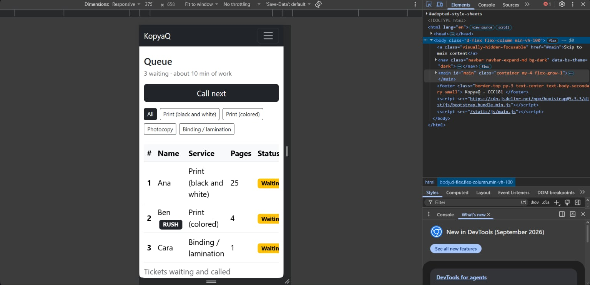
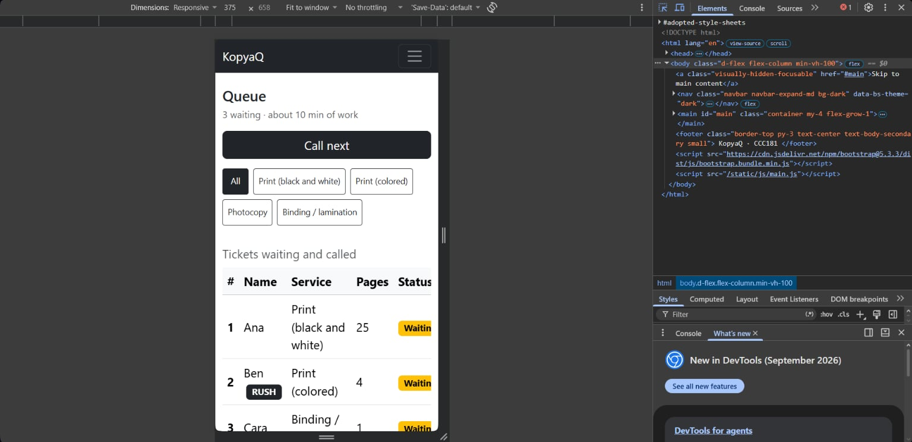

# Week 3 Usability Test: KopyaQ

## Participant

- **Who:** Debbie
- **Matches persona:** Kyla, the student waiting 
- **Why they fit:** Prints at a shop near overpass, infront of MSU-IIT
- **Setup:** on their phone over the same Wi-Fi
- **Date:** 2026-10-24
- **Consent:** I asked permission before taking notes or recording. No full name or face is included.

## Tasks

I gave one task at a time, asked them to think aloud, and did not help.

### Task 1: "You just arrived. Get in line for Print (black and white)."

| | |
| --- | --- |
| **Finished?** yes|
| **Time** | about 45 seconds |
| **Where they hesitated** | asked if a front-and-back page counts as one or two |
| **What they said** | "Do I count the pages or the sheets?" |
| **What surprised me** | I expected email to be optional.|
| **Persona rules** | Did not hold up: none |

### Task 2: "How many people are ahead of you? What is your number?"

| | |
| --- | --- |
| **Finished?** | yes |
| **Time** | about 1 minute |
| **Where they hesitated** | No hesiteation |
| **What they said** | "Number 7, and there's 2 people before me." |
| **What surprised me** | No surprise |
| **Persona rules** | Did not hold up: none |

### Task 3: "Pretend you are the staff member. Call the next person and mark them as served."

| | |
| --- | --- |
| **Finished?** | with help |
| **Time** | about 10 seconds |
| **Where they hesitated** | Hovered between Serve and No-show on the wrong row for a moment |
| **What they said** | "Wait, which one did I just call? Oh, the green one." |
| **What surprised me** | Call next can call several students at once, so someone called after a 50-page job ends up waiting at the counter.|
| **Persona rules** | Did not hold up: Kyla's rule 3 |

## 10b. One improvement

**Problem:** [The most serious problem found, from this test, my self-review, or the accessibility check. Say who it affects and which usability principle it breaks.]

**Fix:** [What I changed in the code, and which file.]

| Before | After |
| --- | --- |
|  |  |
