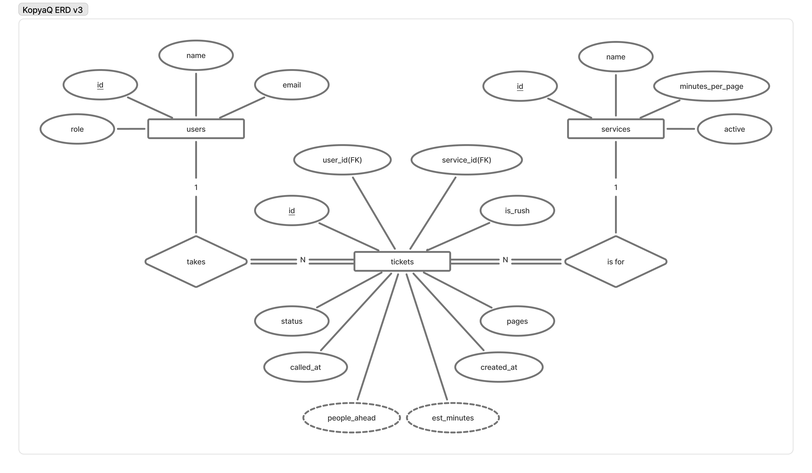
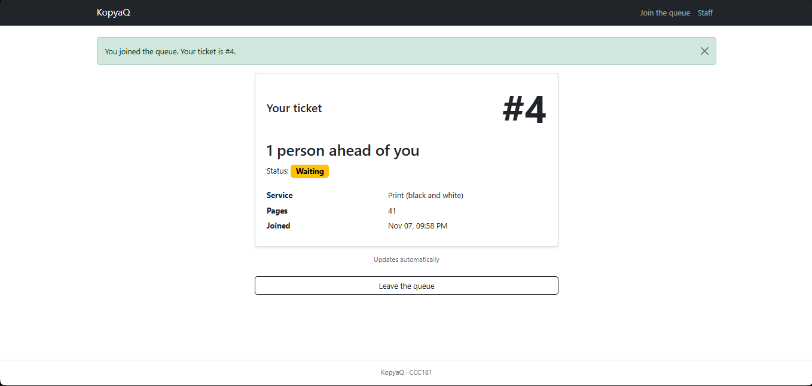
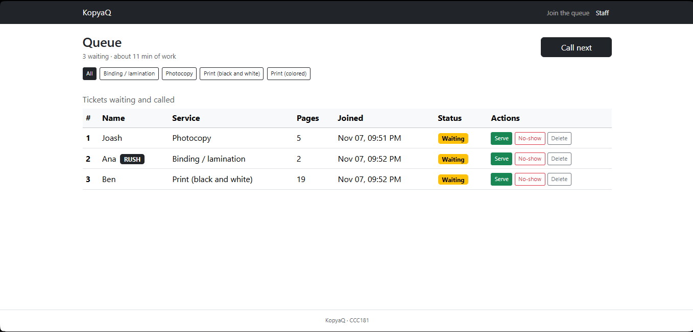
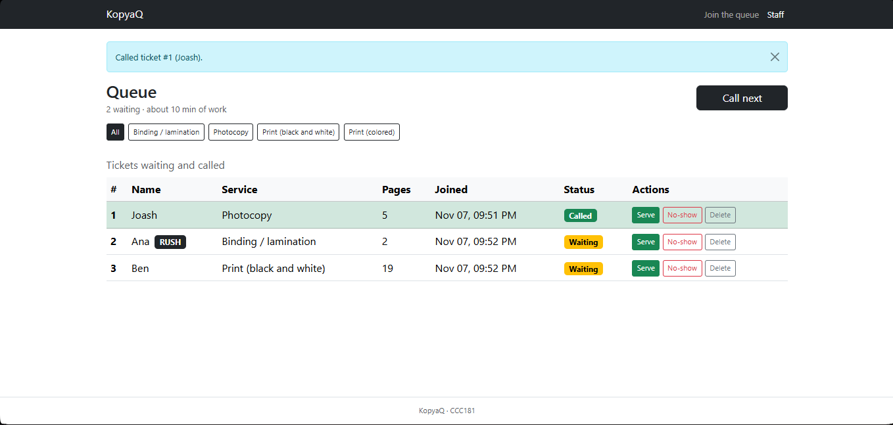
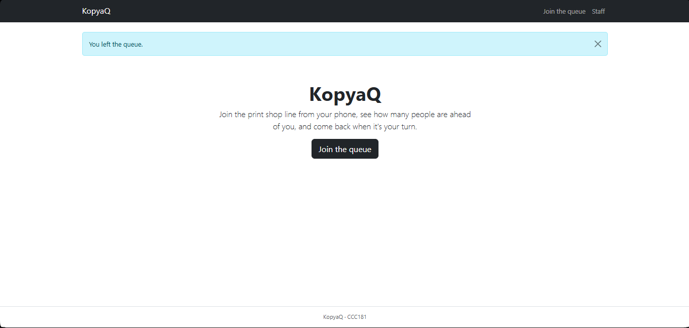
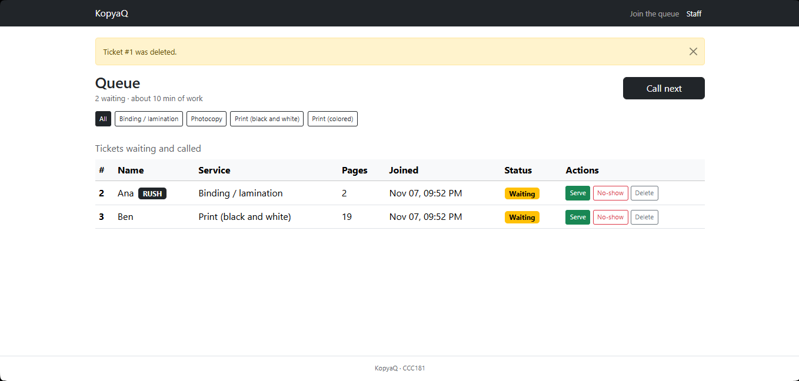
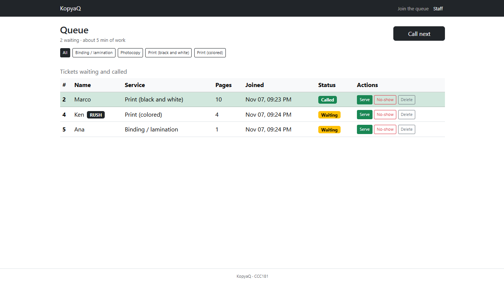
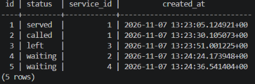
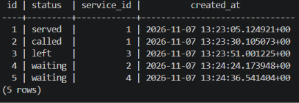
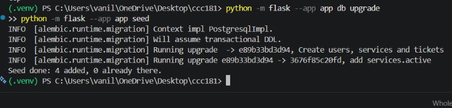

# Week 4 Report: KopyaQ

## 1. Title details

| | |
| --- | --- |
| **App** | KopyaQ |
| **Setting** | A printing and photocopy shop near MSU-IIT |
| **Name** | Joash S. Casiño |
| **Student ID** | 2023-0857 |
| **Section** | CS3A |
| **Date** | 2026-11-07 |
| **Pull request** | [add the link after opening the pull request] |

PostgreSQL 17 runs in Docker Compose. I did not use the local PostgreSQL fallback.

## 2. Requirements

Full list: [docs/requirements.md](../requirements.md).

- **17 functional requirements**, 6 of them marked ★ for this setting (FR-03, FR-06, FR-09, FR-12, FR-13, FR-16)
- **6 non-functional requirements** covering reliability, data integrity, usability, performance, accessibility and security
- **MVP:** FR-01, FR-02, FR-03, FR-04, FR-07, FR-08, NFR-01, NFR-02, NFR-05, NFR-06
- **Out of scope this semester:** online payment, uploading files to print, and SMS notifications

**What the setting said.** Three students who print near campus answered a short Google Form about the list. Two found nothing missing or wrong. One asked: *"Maka indicate if naa pa bay stock for the different paper sizes, and if available ba si colored na option if magpa print kay what if hurot na ang ink."* (Can the app show whether each paper size is in stock, and whether colored printing is available when the ink runs out?) FR-03 (pages and rush) was the most chosen feature, picked by 2 of 3.

**What I changed.** I added FR-16 (paper stock shown to customers, Later) and reworded FR-08 so that switching off a service covers colored printing when the ink runs out. FR-08 was built this week. After the self-review I also added FR-17 (staff login, Week 11).

This week built FR-08, FR-10 and FR-11, and moved FR-01 to FR-07 from a Python list into PostgreSQL.

## 3. ERD



Full design: [docs/week4/schema.md](schema.md).

- **One user takes many tickets (1 : N).** Each ticket is taken by exactly one user.
- **Each ticket is for exactly one service; one service has many tickets (1 : N).**
- The double lines show total participation: every ticket must have a user and a service. The dashed ovals (`people_ahead`, `est_minutes`) are derived values that are computed, never stored.

## 4. Schema

```
                                    Table "public.users"
 Column |          Type          | Collation | Nullable |              Default
--------+------------------------+-----------+----------+-----------------------------------
 id     | integer                |           | not null | nextval('users_id_seq'::regclass)
 name   | character varying(80)  |           | not null |
 email  | character varying(120) |           | not null |
 role   | character varying(20)  |           | not null | 'customer'::character varying
Indexes:
    "users_pkey" PRIMARY KEY, btree (id)
    "users_email_key" UNIQUE CONSTRAINT, btree (email)
Check constraints:
    "ck_users_email_lowercase" CHECK (email::text = lower(email::text))
    "ck_users_name_not_blank" CHECK (length(TRIM(BOTH FROM name)) > 0)
    "ck_users_role" CHECK (role::text = ANY (ARRAY['customer'::character varying, 'staff'::character varying]::text[]))
Referenced by:
    TABLE "tickets" CONSTRAINT "tickets_user_id_fkey" FOREIGN KEY (user_id) REFERENCES users(id) ON DELETE RESTRICT
```

```
                                        Table "public.services"
      Column      |         Type          | Collation | Nullable |               Default
------------------+-----------------------+-----------+----------+--------------------------------------
 id               | integer               |           | not null | nextval('services_id_seq'::regclass)
 name             | character varying(60) |           | not null |
 minutes_per_page | numeric(5,2)          |           | not null | '1'::numeric
 active           | boolean               |           | not null | true
Indexes:
    "services_pkey" PRIMARY KEY, btree (id)
    "services_name_key" UNIQUE CONSTRAINT, btree (name)
Check constraints:
    "ck_services_minutes_per_page" CHECK (minutes_per_page > 0::numeric)
Referenced by:
    TABLE "tickets" CONSTRAINT "tickets_service_id_fkey" FOREIGN KEY (service_id) REFERENCES services(id) ON DELETE RESTRICT
```

```
                                       Table "public.tickets"
   Column   |           Type           | Collation | Nullable |               Default
------------+--------------------------+-----------+----------+-------------------------------------
 id         | integer                  |           | not null | nextval('tickets_id_seq'::regclass)
 user_id    | integer                  |           | not null |
 service_id | integer                  |           | not null |
 pages      | integer                  |           | not null |
 is_rush    | boolean                  |           | not null | false
 status     | character varying(20)    |           | not null | 'waiting'::character varying
 created_at | timestamp with time zone |           | not null | now()
 called_at  | timestamp with time zone |           |          |
Indexes:
    "tickets_pkey" PRIMARY KEY, btree (id)
    "uq_tickets_one_active" UNIQUE, btree (user_id, service_id) WHERE status::text = ANY (ARRAY['waiting'::character varying, 'called'::character varying]::text[])
Check constraints:
    "ck_tickets_pages" CHECK (pages >= 1 AND pages <= 1000)
    "ck_tickets_status" CHECK (status::text = ANY (ARRAY['waiting'::character varying, 'called'::character varying, 'served'::character varying, 'no-show'::character varying, 'left'::character varying]::text[]))
Foreign-key constraints:
    "tickets_service_id_fkey" FOREIGN KEY (service_id) REFERENCES services(id) ON DELETE RESTRICT
    "tickets_user_id_fkey" FOREIGN KEY (user_id) REFERENCES users(id) ON DELETE RESTRICT
```

## 5. Design decisions

1. **Name and email moved off the ticket into a `users` table.** Kyla prints for class every week. In Week 3, every ticket repeated her name and email. Now she has one `users` row and many `tickets` rows, and a returning email reuses the same account (checked with `Ana@G.MSUIIT.edu.ph` and `ana@g.msuiit.edu.ph`, which made two tickets but one user). This puts the schema in third normal form.

2. **One active ticket per customer per service, enforced by the database.** Kyla joins one-handed on slow prepaid data, so a double tap or a second tab could put her in line twice, and the Week 3 guard was JavaScript only. The partial unique index `uq_tickets_one_active` on `(user_id, service_id) WHERE status IN ('waiting', 'called')` blocks this in PostgreSQL, and `join()` turns the `IntegrityError` into "You already have a ticket for this service." Old served, no-show and left tickets do not count, so she can join again next visit.

3. **Services are switched off, not deleted.** When the colored printer runs out of ink (FR-08, from the survey feedback), Ate Joy sets `services.active` to false. The service disappears from the join form, and `join()` refuses it even from a hand-made request, but its old tickets stay for FR-14 reports. Deleting a service that has tickets is refused twice: by a check in `service_delete()`, and by `ON DELETE RESTRICT` on `tickets.service_id`.

## 6. Self-review

Full review: [docs/week4/schema-review.md](schema-review.md).

| Problem | Found with | Decision |
|---|---|---|
| A double tap could put the same person in line twice | Q4, bad data | **Changed:** added the partial unique index `uq_tickets_one_active` |
| RESTRICT blocks a request to delete a customer's data | Q5, deletes | **Kept** RESTRICT; staff replace her name and email with placeholders instead, so FR-14 history stays |
| `users.role` had no requirement behind it | Q1, coverage | **Changed:** added FR-17 (only signed-in staff can use the dashboard, Week 11) |
| The time a ticket was served is not stored | Q3, facts not results | **Kept:** no requirement needs it yet; `served_at` can be added later with a migration |

## 7. Migrations

| Script | What it does |
|---|---|
| `e89b33bd3d94_create_users_services_and_tickets.py` | Creates `services`, `users` and `tickets` with all primary keys, foreign keys (`ON DELETE RESTRICT`), named CHECK constraints, UNIQUE constraints, defaults, and the partial unique index `uq_tickets_one_active`. |
| `3676f85c20fd_add_services_active.py` | Adds `services.active` as a NOT NULL boolean with `server_default` true, so the four existing services were switched on automatically. Its `downgrade()` drops the column. |

Both scripts were reviewed before running. `flask db downgrade` followed by `flask db upgrade` removed and restored `services.active`, and a rebuild from an empty database ran both scripts in order.

## 8. CRUD

| Operation | Route | Requirement | Screenshot |
|---|---|---|---|
| **Create** | `POST /join` | FR-01, FR-03 |  |
| **Read** | `GET /staff` and `GET /queue/<id>` | FR-02, FR-04, FR-06, FR-09, FR-10 |  |
| **Update** | `POST /staff/call-next` and `POST /staff/tickets/<id>/<action>` | FR-04 |  |
| **Soft delete** | `POST /queue/<id>/leave` | FR-07 |  |
| **Hard delete** | `POST /staff/tickets/<id>/delete` | FR-11 |  |

- **Create:** finds or creates the user by lowercase email, saves the ticket, and redirects to My place (Post/Redirect/Get).
- **Read:** My place counts the people ahead with one database query (`people_ahead()`), and the dashboard lists waiting and called tickets in join order, with join times in Philippine time.
- **Update:** Call next sets `status` to `called` and `called_at` to `now()` from the database. It also skips any service that already has someone called, which fixes the Week 3 usability finding that Call next could call several students at once.
- **Soft delete:** only a waiting ticket changes to `left`; the row stays for FR-14.
- **Hard delete:** asks for confirmation (`data-confirm`), then removes the row.

**Manage services** (`/staff/services`, FR-08) adds create, update, switch-off and delete for services. Every route that changes data is a POST.

## 9. Validation

Full results: [docs/week4/validation.md](validation.md).

- **Browser:** the join form uses `required`, `type="email"`, `maxlength="80"` and `"120"`, and pages `min="1" max="1000"`, matching the columns.
- **Flask:** four curl requests that skip the form (empty name with a bad email and a missing service, a 200-character name, a switched-off service, and 5000 pages) all returned `400 BAD REQUEST`, and the ticket count did not change.
- **Database:** every constraint type failed as expected in psql: FOREIGN KEY, NOT NULL, CHECK (status, pages, minutes per page and lowercase email), UNIQUE, RESTRICT, and the partial unique index.
- **SQL injection:** `git grep` found no SQL built with f-strings.

**Most useful finding.** My first switched-off-service test returned `302 FOUND` and saved ticket #15. The service was hidden from the dropdown, but `join()` only checked that the service existed. After adding `or not service.active`, the same request returned 400 and saved nothing. The PostgreSQL error I found most useful was `ERROR: update or delete on table "services" violates foreign key constraint "tickets_service_id_fkey" on table "tickets"`, because it showed that `ON DELETE RESTRICT` protects old tickets even if the app's own check were missing.

## 10. Persistence

Full steps: [docs/week4/persistence.md](persistence.md).

| Before the restart | After the restart |
| --- | --- |
|  |  |
|  |  |

Five tickets across four services (served, called, left and two waiting) were identical after stopping Flask, running `docker compose down`, and starting everything again. Every `id`, `status` and `created_at` matched to the microsecond. **NFR-01 passed.**

**Rebuild:** after `docker compose down -v`, running `flask db upgrade` and `flask seed` recreated the full schema and the four services, and joining worked.



## 11. Reflection

**Hardest this week:** After collecting feedback from students who print near campus, I found it difficult to implement the new and updated functional requirements, as well as update the code and test the changes. 

**Hardest requirement to make testable:** FR-08, it was hard during migration and I have to test its query, as well as checking  crud of its own. I tested it during part 10, found bug where a switched-off service can still join, and fixed it.

**A report Ate Joy would want:** The busiest hours of the day for each service, so she knows when to ask a helper to watch the counter. I will write this query in Week 5 using `created_at` and `service_id`.

## 12. Declaration

- **Claude (Anthropic):** Explaining Docker, PostgreSQL and SQLAlchemy concepts, drafting the requirements, schema, self-review, validation and persistence documents for me to check and edit, drafting code for the models, migrations and routes, reviewing my code and finding bugs, and duplicating and fixing my ERD in FigJam through the Figma connector. I ran every test myself, and I can explain every table, constraint and route.
- **Google Forms and HackMD:** to collect requirements feedback from three students.