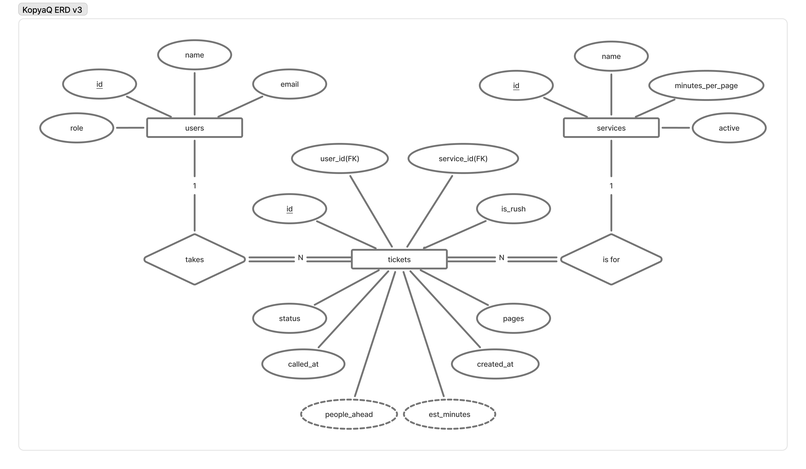

# KopyaQ schema design (Week 4)

This schema is designed from the requirements in [docs/requirements.md](../requirements.md). Every table and column below exists because a requirement marked **Stores data? = Yes** needs it.

## 2a. Nouns in the requirements

Nouns are in **bold**. Nouns become tables; details about a noun become columns.

| Req ID | Requirement | Nouns | Table or column? |
|---|---|---|---|
| FR-01 | A **customer** can join the **queue** for a **service** by entering their **name** and **email** and choosing a service. | customer, queue, service, name, email | users, *(not a table)*, services, users.name, users.email |
| FR-02 | A customer can see their **ticket number**, **status**, and how many people are **ahead** of them. | ticket number, status, ahead | tickets.id, tickets.status, *(computed)* |
| FR-03 ★ | A customer can enter the **number of pages** (1 to 1000) and mark the job as **rush** when joining. | pages, rush | tickets.pages, tickets.is_rush |
| FR-04 | A **staff member** can **call** the next waiting customer, and mark a called ticket as **served** or **no-show**. | staff member, call, served, no-show | users.role, tickets.called_at, tickets.status |
| FR-06 ★ | A staff member can see the **estimated minutes of work** waiting, computed from each ticket's **pages** and each service's **minutes per page**. | estimated minutes, pages, minutes per page | *(computed)*, tickets.pages, services.minutes_per_page |
| FR-07 | A customer can **leave** the queue before being served. | leave | tickets.status = 'left' |
| FR-08 | A staff member can add a service, change its **name** and **minutes per page**, and **switch it off**. | name, minutes per page, switch off | services.name, services.minutes_per_page, services.active |
| FR-09 ★ | A staff member can see which tickets are **rush jobs**. | rush jobs | tickets.is_rush |
| FR-10 | A staff member can see the **time each ticket joined**. | time joined | tickets.created_at |
| FR-11 | A staff member can **delete** a ticket created by mistake. | delete | *(an action, not a column)* |
| FR-12 ★ | A staff member can mark a job as **ready for pickup**. | ready for pickup | Later: a new value 'ready' in tickets.status |
| FR-13 ★ | A customer can choose the **paper size** when joining. | paper size | Later: tickets.paper_size_id |
| FR-14 | A staff member can see how many customers **left** before being served, **per service**, **per day**. | left, per service, per day | *(computed)* from tickets.status, tickets.service_id, tickets.created_at |
| FR-16 ★ | A staff member can mark each **paper size** as **in stock** or out of stock. | paper size, in stock | Later: a paper_sizes table with an in_stock column |

Two rules from this week's lecture, applied to KopyaQ:

- **The queue is not a table.** The queue for a service is all tickets with status `waiting` for that service, ordered by `created_at`.
- **Store facts, not results.** KopyaQ stores *when* a ticket joined (`created_at`) and *how many pages* it has (`pages`). It does **not** store a position in line, a count of people ahead (FR-02), or the estimated minutes of work (FR-06). Those are computed with a query when a page loads, because a stored value would need rewriting for many rows every time someone joins, leaves or is served. The ERD shows them as dashed ovals (`people_ahead`, `est_minutes`), the Chen symbol for a derived attribute, so it is clear they are not columns.

## 2b. Tables and columns

| Table | Columns | What it holds |
|---|---|---|
| `users` | id, name, email, role | One row per person: a customer who joins, or a staff member like Ate Joy |
| `services` | id, name, minutes_per_page, active | One row per service the shop offers |
| `tickets` | id, user_id, service_id, pages, is_rush, status, created_at, called_at | One row per visit to the queue |

Where the Week 3 form fields belong, by asking *is this a fact about the person, about the service, or about this one visit?*

- **Name and email** are about the person, so they move from each Week 3 ticket into `users`. A student who prints every week gets one `users` row and many `tickets` rows, so her email is stored once.
- **Pages** and **rush** are about one visit. Kyla may print 25 pages on Monday and 4 pages as a rush job on Thursday, so both go in `tickets`.
- **Minutes per page** is about the service (a colored page is slower than a photocopy), so it goes in `services`.

Three tables are enough this week. FR-13 and FR-16 (paper size and paper stock) would add a fourth table, `paper_sizes`, in a later week.

## 2c. Types and constraints

| Table | Column | PostgreSQL type | Constraint | Why |
|---|---|---|---|---|
| users | id | integer, generated | PRIMARY KEY | Generated by the database, never reused |
| users | name | varchar(80) | NOT NULL, CHECK (length(trim(name)) > 0) | Every ticket needs a name Ate Joy can call out; a blank name is rejected, not just a missing one |
| users | email | varchar(120) | NOT NULL UNIQUE, CHECK (email = lower(email)) | One account per email (FR-01); stored in lowercase so Ana@G.msuiit.edu.ph and ana@g.msuiit.edu.ph are not two people |
| users | role | varchar(20) | NOT NULL DEFAULT 'customer', CHECK (role IN ('customer', 'staff')) | Only two kinds of user; staff login comes in Week 11 |
| services | id | integer, generated | PRIMARY KEY | Generated by the database |
| services | name | varchar(60) | NOT NULL UNIQUE | Two services with the same name would confuse customers on the join form |
| services | minutes_per_page | numeric(5,2) | NOT NULL DEFAULT 1, CHECK (minutes_per_page > 0) | Needs decimals (0.1 for photocopy, 0.2 for black and white); a number, never text; zero or negative would break FR-06 |
| services | active | boolean | NOT NULL DEFAULT true | FR-08: a service can be switched off (for example, colored printing when the ink runs out) without deleting its old tickets. Added by the second migration in Part 9 |
| tickets | id | integer, generated | PRIMARY KEY | The ticket number customers see. The database generates it, so two people can never get the same number (NFR-02) |
| tickets | user_id | integer | NOT NULL, FOREIGN KEY REFERENCES users(id) ON DELETE RESTRICT | Every ticket belongs to exactly one person |
| tickets | service_id | integer | NOT NULL, FOREIGN KEY REFERENCES services(id) ON DELETE RESTRICT | No ticket for a service that does not exist |
| tickets | pages | integer | NOT NULL, CHECK (pages BETWEEN 1 AND 1000) | FR-03: the same limits as the Week 3 form, enforced again by the database |
| tickets | is_rush | boolean | NOT NULL DEFAULT false | FR-03 and FR-09: a yes or no value, stored as true or false, not as the text "yes" |
| tickets | status | varchar(20) | NOT NULL DEFAULT 'waiting', CHECK (status IN ('waiting', 'called', 'served', 'no-show', 'left')) | Only the five statuses the Week 3 app uses |
| tickets | created_at | timestamptz | NOT NULL DEFAULT now() | FR-10 and the order of the queue. Time zone safe, and set by the database, not by the browser |
| tickets | called_at | timestamptz | NULL | FR-04: empty while a ticket is waiting, filled in when Ate Joy calls it |

Every required constraint type is used at least once: PRIMARY KEY (all three ids), FOREIGN KEY (user_id, service_id), NOT NULL (most columns), UNIQUE (users.email, services.name), CHECK (name, email, role, minutes_per_page, pages, status), and `timestamptz` (created_at, called_at).

## 2d. ERD

The ERD is drawn in **Chen notation**:

| Symbol | Meaning in the KopyaQ ERD |
|---|---|
| Rectangle | An entity (table): `users`, `services`, `tickets` |
| Oval | An attribute (column) |
| Underlined name | The primary key (`id` in each table) |
| `(FK)` after the name | A foreign key (`user_id`, `service_id`). Pure Chen notation leaves foreign keys out because the diamond already shows the link; they are shown here because this activity asks for every PK and FK to be marked |
| Diamond | A relationship: *takes* and *is for* |
| `1` and `N` on the lines | The cardinality of each relationship (1 : N) |
| Double line | Total participation: every ticket **must** have a user and a service (both foreign keys are NOT NULL). The users and services side is a single line, because a user (such as a staff member) or a new service can have no tickets |
| Dashed oval | A derived attribute: computed when needed, never stored (`people_ahead`, `est_minutes`) |

### Relationships, read aloud

- **One user takes many tickets (1 : N).** Each ticket is taken by exactly one user. A student who comes back next week keeps the same user row and gets a new ticket.
- **Each ticket is for exactly one service; one service has many tickets (1 : N).**
- **There is no relationship between users and services.** A customer is linked to a service only through a ticket.

The foreign key always sits on the "many" side, so both foreign keys are in `tickets`.

### What happens when a parent row is deleted

| Foreign key | Rule | Why |
|---|---|---|
| tickets.service_id → services.id | **RESTRICT** | Deleting a service must not delete its old tickets, because FR-14 (who left before being served, per service, per day) needs them. A service that stops is switched off with `active = false` instead (FR-08). |
| tickets.user_id → users.id | **RESTRICT** | A customer's past tickets are part of the shop's history and reports. CASCADE would silently erase them, and SET NULL is not possible because `user_id` is NOT NULL. |

Deleting a **ticket** (FR-11) is always allowed, because no other table points to `tickets`.

## 2e. Normalization check

1. **One value per cell (1NF):** Yes, the schema is in 1NF. No column holds a list. Each ticket is for exactly one service; a student who needs printing *and* binding gets two tickets, not one ticket with "Print, Binding" in a cell.
2. **Depends on the whole key (2NF):** Yes. Every table has a single-column primary key (`id`) and there are no join tables, so no column can depend on only part of a key.
3. **No hidden copies (3NF):** Yes. A person's name and email are stored only in `users`, and a service's name and minutes per page only in `services`. A ticket stores only `user_id` and `service_id`, so renaming "Binding / lamination" changes one row, not every ticket. This fixes a Week 3 problem: each Week 3 ticket repeated the customer's name and email.